# Modelling and Simulation of RC Circuits

**EEE382 – Modelling and Simulation**, BRAC University, Spring 2024 (Group 08)

Three MATLAB/Simulink problems built around one relationship, the capacitor law **I<sub>C</sub> = C·dV<sub>C</sub>/dt**:

| Problem | Topic | Method |
|---|---|---|
| 1 | Capacitor current from sampled voltage | Numerical differentiation, relative error, cubic curve fitting |
| 2 | Two-stage RC ladder | Simulink circuit, transfer function, state-space model, response comparison |
| 3 | Capacitor voltage from a known current | Fourth-order Runge–Kutta (RK4) integration |

The capacitor law is **differentiated** in Problem 1, **embedded in the circuit equations** in Problem 2, and **integrated** in Problem 3.

## Notation

| Symbol | Meaning |
|---|---|
| V<sub>C</sub>, I<sub>C</sub> | Capacitor voltage and current |
| C, R | Capacitance, resistance (G = 8 is the group number, so C = 100 + G = 108) |
| ε<sub>t</sub> | Relative percentage true error = \|(true − approx) / true\| × 100 % |
| G(s) | Transfer function V<sub>o</sub>(s) / V<sub>i</sub>(s) |
| A, B, C, D | State-space matrices: ẋ = Ax + Bu, y = Cx + Du |
| h | Step size (time between samples or integration steps) |
| k₁…k₄ | The four slope evaluations of the RK4 method |

---

## Problem 1: RC circuit analysis

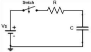

A series RC circuit (C = 108 µF) was sampled every 0.5 ms from 0 to 6.5 ms. Step by step:
1. **Estimate the current** with the forward difference I<sub>C</sub>(t<sub>i</sub>) ≈ C·[V(t<sub>i+1</sub>) − V(t<sub>i</sub>)] / h (MATLAB `diff`).
2. **Compute ε<sub>t</sub>** against the supplied true current at each instant.
3. **Fit a cubic polynomial** (`polyfit`, n = 3) to the true current and evaluate it at 4 ms.

| Result | Value |
|---|---|
| Approximated current | 238.896 mA → 11.880 mA (13 points) |
| Relative error | 4.04 % – 5.27 % (mostly ≈ 4.4 %) |
| Cubic fit at 4 ms | **33.1256 mA** vs true 33.834 mA → **ε<sub>t</sub> = 2.0939 %** |

| Approximated vs true current | Cubic curve fit |
|---|---|
| 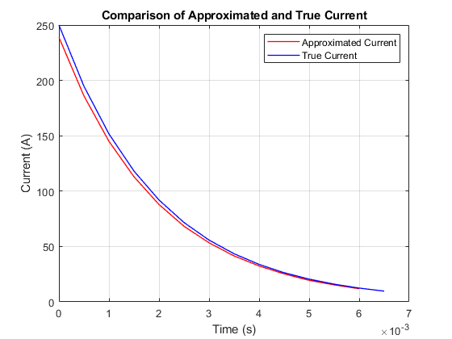 | 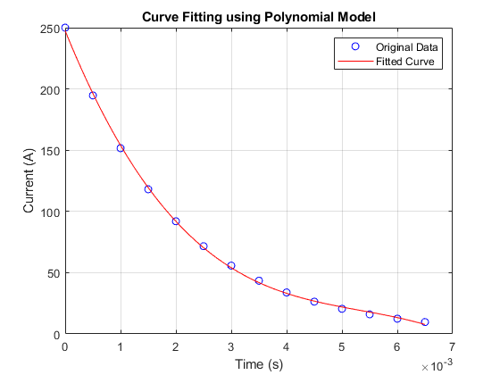 |

Code: [`matlab/problem1/problem1_rc_analysis.m`](matlab/problem1/problem1_rc_analysis.m)

---

## Problem 2: Dynamic system modelling

<p align="center">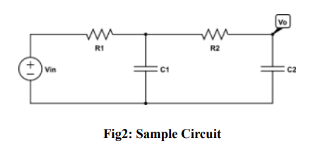</p>

Assumed values: **R₁ = 500 Ω, R₂ = 700 Ω, C₁ = 1 µF, C₂ = 47 µF**. The output V<sub>o</sub> is the voltage across C₂.

**(i) Simulink circuit:** the circuit was built from Simulink electrical blocks (controlled voltage source, R, C, voltage sensor) and driven by a unit step.

| Simulink circuit | Step response |
|---|---|
| 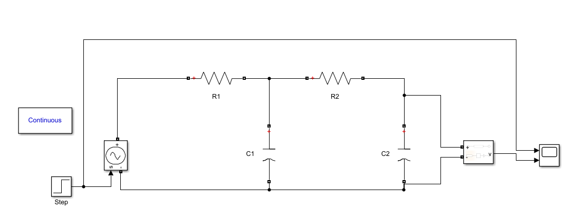 | 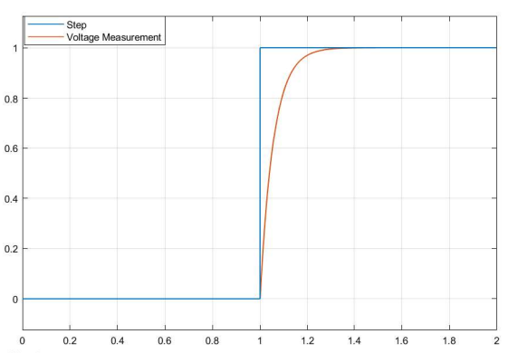 |

**(ii) Transfer function:** applying KCL at both nodes, with each capacitor replaced by 1/(sC), gives

$$G(s)=\frac{V_o}{V_i}=\frac{1}{R_1R_2C_1C_2\,s^2+(R_1C_1+R_2C_2+R_1C_2)\,s+1}=\frac{1}{1.645\times10^{-5}s^2+0.0569s+1}$$

| Simulink LTI block | MATLAB `step` |
|---|---|
| 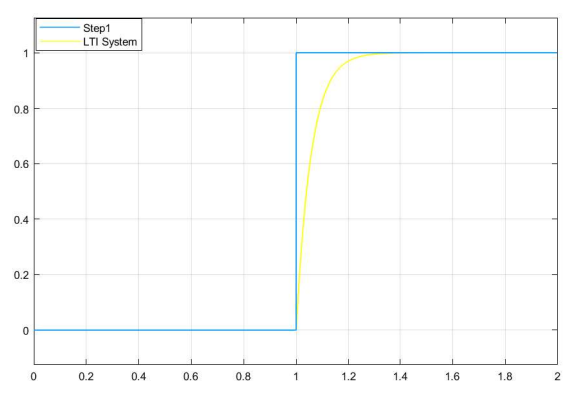 | 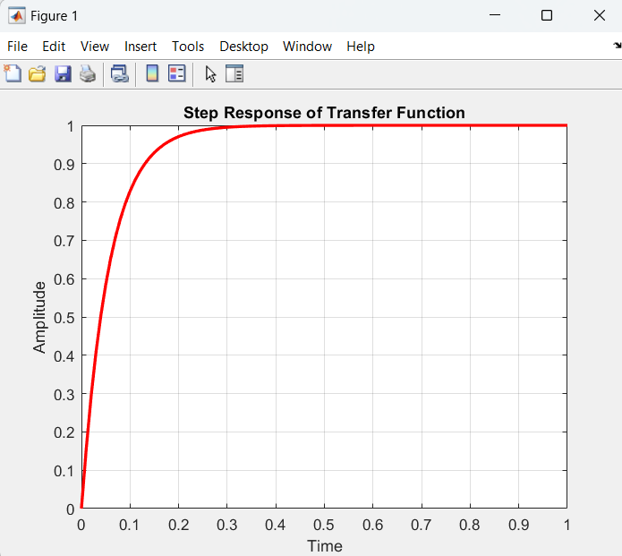 |

**(iii) State-space model:** obtained from the transfer function with `tf2ss` and simulated with `lsim`:

$$A=\begin{bmatrix}-3458.97 & -60790.27\\ 1 & 0\end{bmatrix},\quad B=\begin{bmatrix}1\\0\end{bmatrix},\quad C=\begin{bmatrix}0 & 60790.27\end{bmatrix},\quad D=0$$

| Simulink State-Space block | MATLAB `lsim` |
|---|---|
| 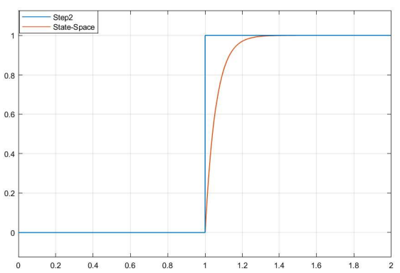 | 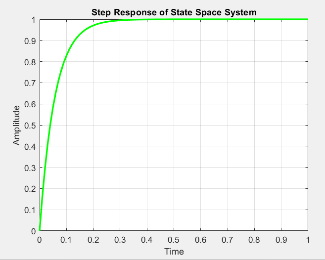 |

**(iv) Comparison:** the LTI and State-Space blocks were driven by the same step. Their responses coincide, rising to 1 with no overshoot. The slow pole (≈ −17.66 s⁻¹, τ ≈ 56.6 ms) dominates.

| Comparison model | Overlay | Separate axes |
|---|---|---|
| 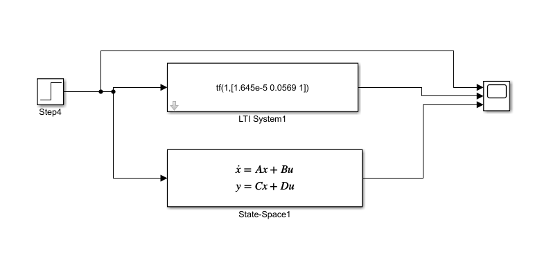 | 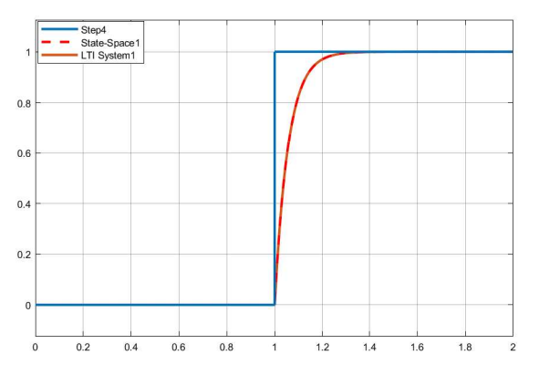 | 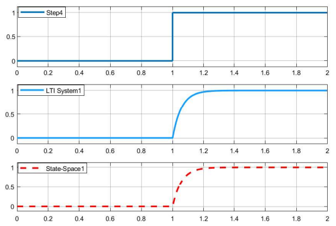 |

Code: [`matlab/problem2/transfer_function.m`](matlab/problem2/transfer_function.m), [`matlab/problem2/state_space.m`](matlab/problem2/state_space.m)

---

## Problem 3: Numerical calculation of capacitor voltage

Given I<sub>C</sub>(t) = 150·e<sup>−0.5t</sup>, C = 108 F and V<sub>C</sub>(0) = 0, the ODE dV<sub>C</sub>/dt = I<sub>C</sub>(t)/C was solved from 0 to 3 s with RK4 at h = 0.5 s. `RK_4.m` is a general Runge–Kutta routine; the nodes and weights passed to it select the classical fourth-order method.

| t (s) | 0 | 0.5 | 1 | 1.5 | 2 | 2.5 | 3 |
|---|---|---|---|---|---|---|---|
| Calculated V<sub>C</sub> (V) | 0 | 0.6144 | 1.0930 | 1.4657 | 1.7559 | 1.9819 | 2.1580 |
| True V<sub>C</sub> (V) | 0 | 1.106 | 1.967 | 2.638 | 3.161 | 3.568 | 3.884 |

| Part A: RK4 result | Part B: calculated vs true |
|---|---|
| 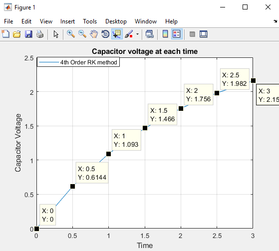 | 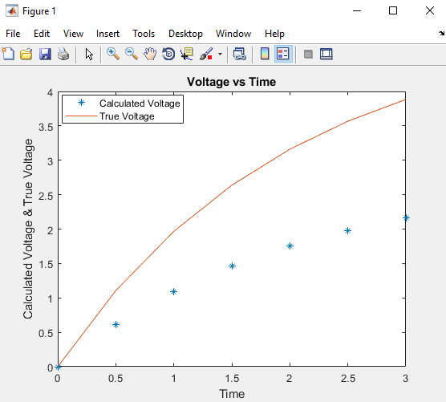 |

The RK4 result matches the closed-form solution V<sub>C</sub>(t) = (300/108)(1 − e<sup>−0.5t</sup>) to within 3 µV. The gap from the "true" table is a constant factor of 60/108 at every point, so it comes from the supplied data (current amplitude, capacitance and table don't agree with each other), not from the numerical method.

Code: [`matlab/problem3/RK_4.m`](matlab/problem3/RK_4.m), [`partA_capacitor_voltage.m`](matlab/problem3/partA_capacitor_voltage.m), [`partB_calculated_vs_true.m`](matlab/problem3/partB_calculated_vs_true.m)

---

## Running the code

Requires MATLAB with the **Control System Toolbox** (`tf`, `step`, `ss`, `lsim`) and the **Signal Processing Toolbox** (`tf2ss`) for Problem 2. Run each script from its own folder; the Problem 3 scripts call `RK_4.m`, which sits in the same folder.

```matlab
cd matlab/problem1, problem1_rc_analysis
cd ../problem2,     transfer_function, state_space
cd ../problem3,     partA_capacitor_voltage, partB_calculated_vs_true
```

The Simulink models were not preserved; their block diagrams and scope outputs are kept as screenshots in [`figures/problem2/`](figures/problem2/).

## Notes from the report review

- **Problem 1:** the brief says "t = 4 sec", but the data are in milliseconds, so the code evaluates the fit at 4 ms. The ≈ 4.4 % error comes from two partly cancelling biases: the forward-difference lag (−11.5 %) and C = 108 µF where the data imply 100 µF (+8 %).
- **Problem 2:** the handwritten state-space page has a sign error in A(1,2), which would make the system unstable as written. The MATLAB `tf2ss` result used for the plots is correct.
- **Problem 3:** the report table lists 1.1093 V at 1 s and 2.153 V at 3 s; the routine gives 1.0930 V and 2.1580 V (the values shown above).

Full details are in the report's technical notes and Appendix C.

## Repository structure

```
├── matlab/
│   ├── problem1/   problem1_rc_analysis.m
│   ├── problem2/   transfer_function.m, state_space.m
│   └── problem3/   RK_4.m, partA_capacitor_voltage.m, partB_calculated_vs_true.m
├── figures/
│   ├── problem1/  problem2/  problem3/   MATLAB plots and Simulink screenshots
│   ├── derivations/                      handwritten transfer-function, state-space and RK4 pages
│   └── command_window/                   MATLAB output screenshots
└── report/        full project report (PDF + DOCX)
```

## Team

Group 08: Zohara Kamal, Tanima Abbas, Anwar Shadman, Md Istiauk Hossain Rifat
